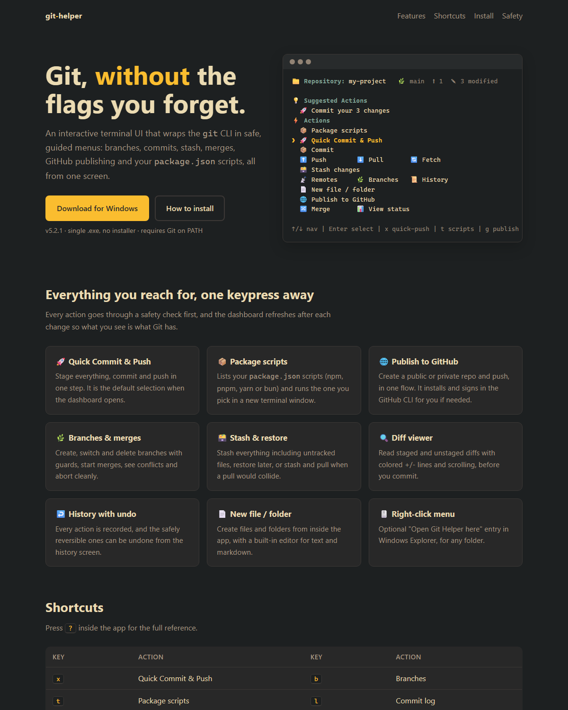
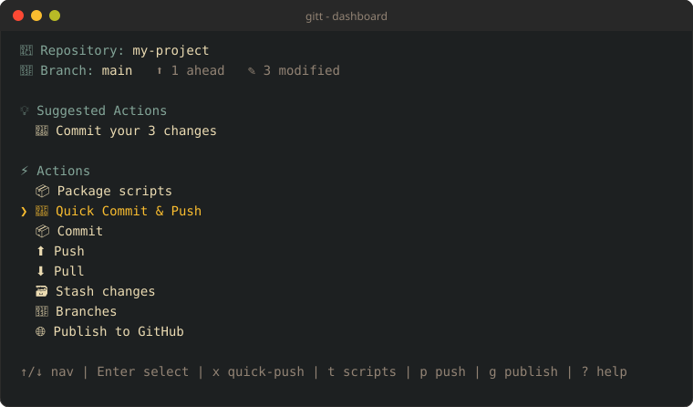
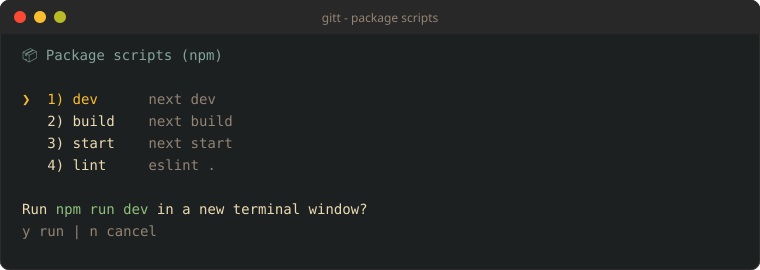
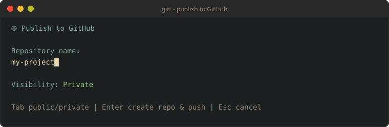

# Git Helper

An interactive terminal UI for Git: branches, commits, stash, merges, GitHub publishing and your `package.json` scripts, all from one screen, with a safety check before every destructive action.



**[⬇️ Download for Windows (v5.2.1)](https://github.com/sspotter/git-helper-showca/releases/download/cli/git-helper-v5.2.1.exe)** — single `.exe`, no installer. Requires Git on your `PATH`.

## Screens

### Dashboard
Opens with 🚀 Quick Commit & Push selected. Everything else is one key away.



### Package scripts (`t`)
Lists your `package.json` scripts (npm, pnpm, yarn or bun, chosen by lockfile) and runs the one you pick in a new terminal window.



### Publish to GitHub (`g`)
Creates a public or private repo and pushes. Installs and signs in the GitHub CLI for you if needed.



> The three terminal images are illustrations of the screens, not live captures.

## Functions

| Action | Key | What it does |
|---|---|---|
| 📦 Package scripts | `t` | List `package.json` scripts and run one in a new terminal |
| 🚀 Quick Commit & Push | `x` | Stage everything, commit and push in one step |
| 📦 Commit | `c` | Staging-area commit flow with a multi-line message |
| ⬆️ Push | `p` | Push, with a preview of what will be sent |
| ⬇️ Pull | — | Pull, warning first if the working tree is dirty |
| 🔄 Fetch | `f` | Fetch from the remote |
| 🗃️ Stash changes | `z` | Stash everything, including untracked files |
| 🗃️ Restore stash | `Z` | Restore the most recent stash |
| 📡 Remotes | `o` | View remotes, add one or edit a URL |
| 🌿 Branches | `b` | Create, switch and delete branches with guards |
| 📜 History | `h` | Git Helper's action history, with undo for reversible actions |
| 📄 New file / folder | `n` | Create files and folders, with a built-in text/markdown editor |
| 🌐 Publish to GitHub | `g` | Create a public/private repo and push |
| 🔀 Merge | `m` | Start a merge, see conflicts, abort cleanly |
| 📜 View commits | `l` | Browse and inspect recent commits |
| 📊 View status | `s` / `v` | Detailed working-tree status and diffs |
| ⚡ Refresh | `r` | Re-read repository state |
| ❓ Help | `?` | Full keyboard reference |
| 🚪 Exit | `q` | Quit |

## Install

1. Download `git-helper-v5.2.1.exe` and put it somewhere you keep tools.
2. Run it from any repository folder.
3. Optional: rename it to `gitt.exe` and add its folder to your `PATH` so `gitt` works in PowerShell, cmd and Git Bash.

```text
gitt             # open the dashboard
gitt -n          # list package.json scripts in the terminal
gitt --version
```

## Deploy this site

Pages deploys from `master` through `.github/workflows/static.yml`. The exe is not stored in the repo (`*.exe` is gitignored); it is a release asset on the `cli` release. To update, upload the new exe to that release and change the link and version in `index.html` and this file.
